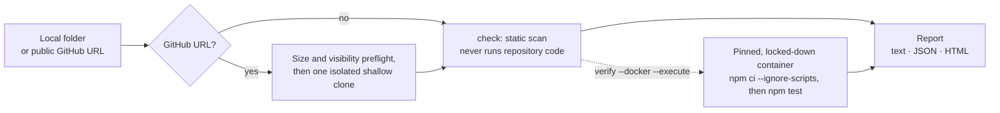

<div align="center">


<br>

[](https://github.com/psuvraneel-cyber/Clone-Proof/releases/latest)
[](https://github.com/psuvraneel-cyber/Clone-Proof/actions/workflows/ci.yml)
[](docs/RELEASING.md#verifying-a-release)


[](LICENSE)

**[Quick start](#-quick-start)** · **[What it catches](#-what-it-catches)** · **[How it works](#-how-it-works)** · **[Safety](#-safe-by-design)** · **[Field-tested](#-field-tested)** · **[Docs](#-documentation)**

</div>

---

> **"It works on my machine."** Then someone clones your repo, follows the README… and it doesn't run.
> A missing lockfile. No test script. An environment variable nobody wrote down. Node 22 in `.nvmrc`, Node 20 in the Dockerfile.

**CloneProof finds those problems before a newcomer, a reviewer, or your CI does.** Point it at a local folder or a public GitHub URL, and it reports every setup problem it can prove, each with the file, the line, and a fix.

<table>
<tr>
<td width="33%" valign="top">

### 🔍 Static check
`cloneproof check` reads the repository and **never runs its code**. Results take seconds, and the same commit always gives the same report.

</td>
<td width="33%" valign="top">

### 🐳 Opt-in proof
`cloneproof verify --docker --execute` runs `npm ci` and `npm test` in a pinned, locked-down container, with the **network off** by default.

</td>
<td width="33%" valign="top">

### ⚙️ Built for CI
A native **GitHub Action** with inline annotations, a Job Summary, CI-friendly exit codes, and reports in text, JSON, or self-contained HTML.

</td>
</tr>
</table>

CloneProof doesn't claim a repository is "safe" or universally reproducible. Every report says what was checked, shows the evidence behind each finding, and lists **what was not checked**.

---

## 🚀 Quick start

**Requirements:** Node.js ≥ 22.19.0 and npm. Docker is only needed for `verify`.

**Try it once, no install:**

```bash
npx github:psuvraneel-cyber/Clone-Proof#v0.1.1 check https://github.com/tj/commander.js
```

**Install the release** (built and attested by CI):

```bash
npm install -g https://github.com/psuvraneel-cyber/Clone-Proof/releases/download/v0.1.1/cloneproof-0.1.1.tgz

cloneproof check ./my-project                 # a local folder: read-only, no network, no code execution
cloneproof check https://github.com/owner/repo  # a public GitHub repository
```

> [!WARNING]
> Don't run `npm install -g cloneproof`. That npm name belongs to a **different project**, so install from the URL above.

<details>
<summary><b>Verify the download before installing</b></summary>

Fetch the tarball and `SHA256SUMS` from the [v0.1.1 release](https://github.com/psuvraneel-cyber/Clone-Proof/releases/tag/v0.1.1), then:

```bash
sha256sum -c SHA256SUMS            # macOS: shasum -a 256 -c SHA256SUMS
gh attestation verify cloneproof-0.1.1.tgz --repo psuvraneel-cyber/Clone-Proof
npm install -g ./cloneproof-0.1.1.tgz
```

The tarball contains only `src/`, `README.md`, `CHANGELOG.md`, `LICENSE`, and `package.json`, and has no dependencies.

</details>

### In GitHub Actions

```yaml
- name: Run CloneProof Static Check
  uses: psuvraneel-cyber/Clone-Proof@v0.1.1
  with:
    target-path: '.'
    mode: 'check' # default: read-only static scan, safe on every pull request
```

Findings show up as annotations on the pull request diff, and a Job Summary lists the results. To prove install and tests on trusted events (`push`, `workflow_dispatch`) on Linux runners:

```yaml
- name: Run CloneProof Docker Verification
  uses: psuvraneel-cyber/Clone-Proof@v0.1.1
  with:
    target-path: '.'
    mode: 'verify' # static check + locked-down Docker verification
    allow-network: 'false' # default: network isolated (--network=none)
    timeout-ms: '300000' # default: 5 minutes (max 600000)
```

Pin a release tag such as `@v0.1.1`, or the release's full commit SHA for supply-chain-sensitive workflows (`uses: psuvraneel-cyber/Clone-Proof@<commit-sha> # v0.1.1`). Don't use `@main`: it changes with every merge. While the version is `0.x` there is no moving major tag, so upgrades are always explicit; see [Releases](https://github.com/psuvraneel-cyber/Clone-Proof/releases) and the [changelog](CHANGELOG.md). Inputs, outputs, annotations, and the Job Summary are documented in [docs/GITHUB_ACTION.md](docs/GITHUB_ACTION.md).

### Prove that install and tests really work

```bash
cloneproof setup                                                    # one-time: prepare the pinned verifier image
cloneproof verify ./my-project --docker --execute                   # network off by default
cloneproof verify ./my-project --docker --execute --allow-network   # only for repositories you trust
```

---

## 👀 See it in action

Real output from the included broken example, `cloneproof check examples/broken-node` (shortened):

```text
CloneProof — repository setup verification
Target: broken-node
Status: failed

Finding counts:
  Total: 9
  Passed: 5
  Failed: 1
  Warnings: 3

[FAIL] TEST_SCRIPT_MISSING — The package test script is missing
  Message: package.json does not define a non-empty scripts.test entry.
  Evidence:
    - package.json — scripts.test is missing or empty.
    - README.md:7 — README references npm run test.
  Recommendation: Add a deterministic scripts.test command that runs the repository test suite.

[WARN] ENV_EXAMPLE_MISSING — No environment example file documents the source environment keys
  Message: Source references APP_TOKEN, but no .env.example, .env.sample, or other committed root .env file documents them.
  Evidence:
    - src/index.js:1 — Source references undocumented environment key APP_TOKEN.

[WARN] RUNTIME_VERSION_MISMATCH — Runtime declarations disagree
  Message: Node.js declarations contain multiple major versions (20, 22).
  Evidence:
    - .nvmrc — Runtime declared in .nvmrc. Found 22.19.0.
    - Dockerfile — Node base image declaration. Found 20.0.0.
    - package.json — Exact engines.node runtime declaration. Found 20.0.0.
```

Exit code `1`, so a CI pipeline stops right there. Try both bundled examples:

```bash
cloneproof check examples/healthy-node     # passed, exit 0
cloneproof check examples/broken-node      # failed, exit 1
```

---

## 🎯 What it catches

| Problem a newcomer hits | Finding |
|---|---|
| No lockfile, so dependency versions drift | `LOCKFILE_MISSING` |
| Lockfile out of sync with `package.json`, or several conflicting lockfiles | `LOCKFILE_OUT_OF_SYNC`, `MULTIPLE_LOCKFILES` |
| `packageManager` disagrees with the lockfile | `PACKAGE_MANAGER_LOCKFILE_MISMATCH` |
| Tests exist, but there is no `npm test` (or only the npm placeholder) to run them | `TEST_SCRIPT_MISSING`, `TEST_SCRIPT_PLACEHOLDER` |
| The repository has no tests at all | `NO_TESTS_FOUND` (warning; `--require-tests` makes it fail) |
| The README tells you to run a script that doesn't exist | `README_SCRIPT_UNKNOWN` |
| The code reads environment variables nobody documented | `ENV_EXAMPLE_MISSING`, with `file:line` for each reference |
| `.nvmrc`, `engines.node`, and the Dockerfile disagree | `RUNTIME_VERSION_MISMATCH` |
| A core file such as the lockfile is gitignored | `CORE_FILE_GITIGNORED` |
| Build output is referenced but not committed | `BUILD_OUTPUT_MISSING` (info) |
| The project needs a database, cache, or broker | `SERVICES_LIKELY_REQUIRED` (info) |
| Private registry or Git-hosted dependencies | `PRIVATE_REGISTRY`, `GIT_DEPENDENCIES` |
| `verify`: tests "pass" but **zero tests ran** | `VERIFY_NO_TESTS_RAN`, reported as **failed** |

Every report also lists **what was not checked** (build steps, starting services, OS-specific scripts, registry credentials, non-README docs, browser and native-build tests), so a `passed` result never overclaims. The complete list of codes, statuses, and severities is in [docs/FINDINGS.md](docs/FINDINGS.md).

<details>
<summary><b>How noise is kept down</b></summary>

- **Environment checks** skip example, fixture, mock, docs, benchmark, perf, tooling, and CI scopes at any depth, plus conventional CI and test-tool prefixes (`CI_*`, `GITHUB_*`, `JEST_*`, `PLAYWRIGHT_*`, …). A variable with a literal fallback (`process.env.PORT ?? "3000"`) or a destructuring default counts as optional, but only if *every* reference has one. Committed root `.env` files (`.env.development`, `.env.default`, …) count as documentation; CloneProof reads only their key names, never their values. Keys a framework sets itself (Vite's `import.meta.env.DEV`, create-react-app's `PUBLIC_URL`, WXT browser flags, values injected by a build-time define map) are not reported. `AZURE_*` is deliberately **not** skipped, because keys like `AZURE_STORAGE_CONNECTION_STRING` are real application settings.
- **`BROWSER_TESTS_DETECTED`** fires only when `npm test` actually runs a browser: a dedicated browser runner (Playwright, Cypress, Karma, Puppeteer, Web Test Runner), or Vitest with `--browser` or `browser.enabled: true` in the configuration it loads.
- **`VERIFY_NO_TESTS_RAN`**: `npm test` exited `0`, but the output matched a zero-test result (node:test, Jest, Vitest, Mocha, AVA, tap). It is reported as a **failed** verification, with the matched line as evidence.
- **No tests is a warning, not a failure:** a repository with no test files and no README test instructions gets `NO_TESTS_FOUND` (a warning). A missing or placeholder test script fails only when there are tests that `npm test` can't run. Use `--require-tests` (Action: `require-tests: 'true'`) to make a repository without tests fail. The exact rules are in [docs/FINDINGS.md](docs/FINDINGS.md#test-script-policy).
- **Advisory, not failures:** `GIT_METADATA_REQUIRED` (a test script needs `.git`, which the Docker snapshot removes), `PACKAGE_MANAGER_UNRECOGNIZED`, and `MONOREPO_ROOT_TEST_SCRIPT_MISSING`.

</details>

<details>
<summary><b>All check groups</b></summary>

| ID | Check group |
|---|---|
| `package-manifest` | Package manifest |
| `lockfile-presence-validity-sync` | Lockfile presence, validity, and synchronization |
| `package-manager-consistency` | Package-manager consistency |
| `test-script` | Test script |
| `readme-npm-commands` | README npm commands and setup-manager consistency |
| `env-documentation` | Environment documentation |
| `node-runtime-declarations` | Node runtime declarations |
| `gitignored-core-files` | Gitignored core files |
| `install-scripts` | Install scripts that the Docker profile intentionally skips |
| `browser-tests` | Browser tooling reachable from the test workflow |
| `nested-packages` | Nested package boundaries |
| `project-classification` | Project classification |
| `package-sources` | Package registries and Git dependency hosts |
| `build-output` | Declared build output files |
| `service-indicators` | Compose files and service dependency indicators |

The JSON report's `coverage.checked` lists the groups actually attempted for that target, and `coverage.notChecked` the fixed out-of-scope list.

</details>

---

## 🧭 How it works



Reports are **deterministic**: relative paths only, no timestamps, and sorted output, so the same repository at the same commit gives byte-identical JSON every time. The HTML report has no scripts and makes no external requests, so it's safe to attach to an issue or a pull request.

---

## 🛡️ Safe by design

Target repositories are treated as **untrusted input**.

| | `check` | `verify --docker --execute` |
|---|---|---|
| Runs repository code? | **Never.** Local scans start no process at all. | Only `npm ci --ignore-scripts` and `npm test`, inside the container |
| Network | GitHub preflight and one clone, for GitHub URLs only | **Off by default**; `--allow-network` is a separate, explicit choice |
| Where it runs | On your machine, read-only | Pinned image `node:22.19.0-bookworm-slim@sha256:4a48…2b90`, never pulled implicitly |
| Isolation | Bounded traversal; symlinks skipped; home folders and drive roots refused | Non-root user, dropped capabilities, `no-new-privileges`, read-only source, no Docker socket, no host environment |
| Limits | File, size, and depth bounds reported instead of hanging | 1 CPU, 2 GiB memory, 512 processes, 5-minute default timeout (max 10), bounded output |
| Cleanup | Clones deleted after the scan | Containers and temp folders removed, even after Ctrl+C or a hard kill |

**GitHub targets:** only public `https://github.com/OWNER/REPO` URLs. Private, missing, or >4 GiB repositories are blocked **before** cloning, and the clone uses an **empty Git config** with no credential helpers, LFS smudging, or host settings. An optional `CLONEPROOF_GITHUB_TOKEN` / `GITHUB_TOKEN` is used **only** for the API preflight. It is never passed to Git or Docker, and never written to reports or logs.

**GitHub Action:** Docker verification runs only on Linux runners for `push` and `workflow_dispatch`, decided from GitHub's own event metadata. Pull requests always get the safe static check.

> [!IMPORTANT]
> Docker is not a complete security boundary. `verify` is a reproducibility check, not a safety certification. See [docs/SECURITY.md](docs/SECURITY.md) for the full trust model.

---

## 🚦 Results and exit codes

| Status | `check` meaning | `verify` meaning | Exit |
|---|---|---|:-:|
| ✅ `passed` | No known problem in the checks that ran (not a guarantee) | `npm ci` and `npm test` succeeded in the container | `0` |
| 🟡 `passed_with_warnings` | Completed, with advisory findings to review | Succeeded, with static warnings or omitted local files | `0` |
| ❌ `failed` | A blocking finding, such as tests that `npm test` can't run or an out-of-sync lockfile | Install or tests failed, **zero tests ran**, or cleanup wasn't confirmed | `1` |
| ⛔ `blocked` | Safely refused: unsupported root, private repository, invalid URL, limits | Missing consent, Docker, image, network consent, or symlink policy | `2` |
| ⚠️ `incomplete` | Something couldn't be inspected completely | Source couldn't be scanned or staged completely | `2` |

<details>
<summary><b>Usage reference</b></summary>

```text
cloneproof check  <path-or-github-url> [--require-tests] [--format text|json|html] [--output FILE] [--receipt FILE] [--color|--no-color]
cloneproof verify <path-or-github-url> --docker --execute [--allow-network] [--timeout-ms N] [--require-tests]
                                       [--format text|json|html] [--output FILE] [--receipt FILE] [--color|--no-color]
cloneproof setup
cloneproof receipt verify <receipt-file>
cloneproof --version
```

| Option | What it does |
|---|---|
| `--format text\|json\|html` | Text for people, canonical JSON for CI, self-contained HTML to share |
| `--output FILE` | Write the report to a file (creates missing folders) |
| `--color` / `--no-color` | Terminal color preference; `NO_COLOR` always disables it |
| `--docker --execute` | Both required to run anything in `verify` |
| `--allow-network` | Allow network in the container; trusted repositories only |
| `--require-tests` | Treat a repository without tests as failed instead of a `NO_TESTS_FOUND` warning |
| `--timeout-ms N` | Verification time limit (default 5 minutes, max 10) |
| `--receipt FILE` | Also write a reproducibility receipt (opt-in; must differ from `--output`) |

**GitHub URLs:** `https://github.com/OWNER/REPO` works, including variants with `www.`, a trailing `/`, `?tab=…`, or `#readme`. `/tree/…` and `/blob/…` links are rejected with the correct URL suggested. A missing local path shaped like `owner/repo` gets a "Did you mean https://github.com/owner/repo?" hint.

Working from a clone of this repository instead of an install? Replace `cloneproof` with `node src/cli.js`.

</details>

<details>
<summary><b>Reproducibility receipts</b></summary>

`--receipt FILE` writes a separate, versioned JSON record of the run: the source commit (read from local Git metadata without running Git, or from CloneProof's GitHub clone), the CloneProof version, mode, whether repository commands ran and where, the Docker image digest and network policy, the outcome, finding codes, coverage, and cleanup. It carries a SHA-256 digest over a canonical JSON form, and `cloneproof receipt verify FILE` checks the schema and digest (exit `0` valid, `1` invalid or mismatched, `2` unreadable or unsupported).

A receipt is **not** a signature or a security certification: anyone who can edit it can recompute the digest, so the digest only detects changes when you trust the expected value from elsewhere. Receipt failures are reported separately and never change the exit code. See [docs/RECEIPTS.md](docs/RECEIPTS.md).

</details>

---

## 📊 Field-tested

CloneProof is measured on real repositories, with the method written down before each run. Full commands, target commits, and every per-finding judgment are in [docs/FIELD_TEST.md](docs/FIELD_TEST.md).

| Measure | Result |
|---|---:|
| Random sample, pre-registered (Run 5, 50 repositories) | 13 failed (exit 1), 36 passed, 1 incomplete |
| Blocking findings, Run 5 | **14 / 14 factually correct**; 4 / 14 actionable, 10 were "this repo has no tests" |
| Warnings, Run 5 | 8 / 26 real (30.8%); 13 / 26 false, mostly `ENV_EXAMPLE_MISSING` and `BROWSER_TESTS_DETECTED` |
| Warnings, Run 5 rerun after the env and browser fixes | **1 / 31 false** (was 13 / 26); the rest are real or optional settings |
| Hand-picked repositories (Run 3) | **13 correct + 2 environment-limited** out of 15; warning precision 5 / 6 |
| Planted-bug mutations (offline) | **13 / 13** detected |
| Planted bugs in real repositories | **39 / 39** detected across 3 repositories |
| Automated tests | **434** (offline, `npm test`) |
| CI | Ubuntu · macOS · Windows · Docker end-to-end · GitHub Action end-to-end |
| Output determinism | Byte-identical JSON across repeated runs on 10 public repositories |

Run 5 is the honest noise measurement. Blocking findings were never wrong, but most fired on repositories that have no tests at all. Two warning checks were noisy in the wild; after fixing them, a rerun of the same 50 repositories went from 13 false warnings to 1, and most remaining environment warnings are true but name optional settings.

---

## 🧱 Limitations

- Focused on the **root package** of Node.js / TypeScript repositories. Monorepo sub-packages are listed and can be checked one at a time.
- `verify` supports **npm** only; pnpm, Yarn, and Bun projects are checked statically but blocked from execution.
- Only the root `.gitignore` (and `.git/info/exclude`) is read.
- Repositories that commit symlinks are blocked from `verify`.
- No private repositories, and it doesn't start external services or run build steps.
- Mixed-language repositories work when the root has a `package.json`; a Python, Go, Rust, or Java root is reported as `UNSUPPORTED_ROOT`.

## 🗺️ Roadmap

- pnpm and Yarn verification profiles
- Detecting OS-specific setup and scripts
- Stronger isolation (gVisor or a dedicated VM)
- A size watchdog during clones
- Safe symlink recreation inside the container
- Remaining Run 5 noise: one grouped finding instead of one per undocumented env key, and public npm mirrors reported apart from private registries

---

## 🤝 Contributing

Contributions are welcome. The most useful thing right now is a report when CloneProof gets your repository wrong: open a **[wrong-or-noisy-finding report](https://github.com/psuvraneel-cyber/Clone-Proof/issues/new?template=false_positive.yml)**. For questions and ideas, use [Discussions](https://github.com/psuvraneel-cyber/Clone-Proof/discussions).

```bash
git clone https://github.com/psuvraneel-cyber/Clone-Proof.git
cd Clone-Proof
npm ci
npm test               # 434 offline tests
npm run test:leaks     # same suite with an isolated temp folder; fails on any leftover file
npm run build          # syntax check
```

Read [CONTRIBUTING.md](CONTRIBUTING.md) first: it lists the guarantees every change must keep. Please report security issues privately as described in [SECURITY.md](SECURITY.md). No secrets are needed for development; `.env.example` is a placeholder template only.

<details>
<summary><b>Docker image of CloneProof itself</b></summary>

```bash
docker build -t cloneproof .
docker run --rm --network none cloneproof
```

</details>

## 📚 Documentation

| | |
|---|---|
| [GitHub Action](docs/GITHUB_ACTION.md) | Inputs, outputs, annotations, Job Summary, Docker verification |
| [Finding codes](docs/FINDINGS.md) | Every code, status, severity, and check group |
| [Security model](docs/SECURITY.md) | Trust boundary, container profile, and documented limits |
| [Field tests](docs/FIELD_TEST.md) | Methods, raw results, and judgments for every run |
| [Receipts](docs/RECEIPTS.md) | Reproducibility receipt format and verification |
| [Architecture](docs/ARCHITECTURE.md) · [Design decisions](docs/DECISIONS.md) | How it's built and why |
| [Releasing](docs/RELEASING.md) · [Changelog](CHANGELOG.md) | Release process and version history |
| [Demo script](docs/DEMO.md) | A guided walkthrough |

---

<div align="center">

Built for the **OmniRush Frontier Buildathon 2026** · Track: Developer Tools & Open Source · [Checklist](docs/BUILDATHON_CHECKLIST.md) · [Event](https://omnirush.ai/buildathon)

Released under the [MIT License](LICENSE).

</div>
