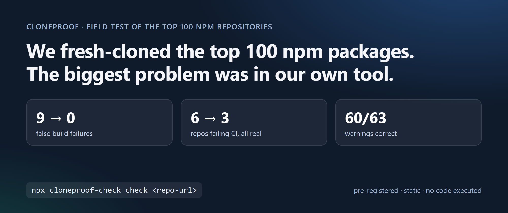
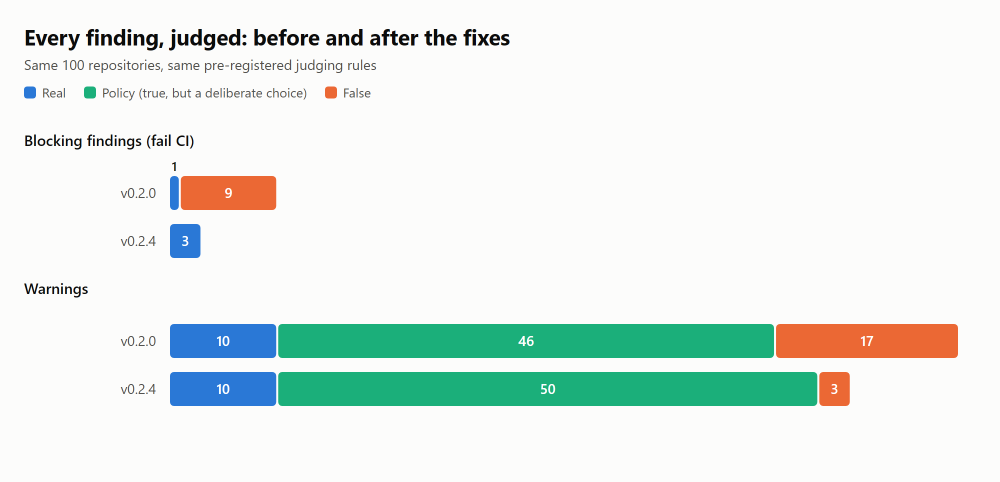
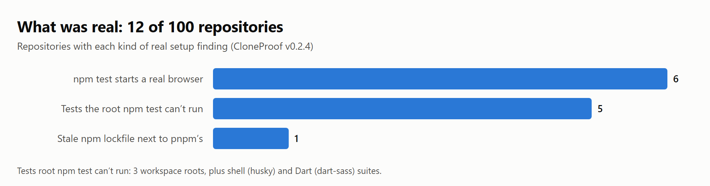
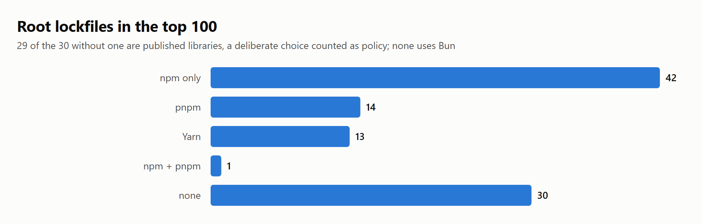

# We fresh-cloned the top 100 npm packages. The biggest problem we found was in our own tool.



*Draft, not published. Every number below comes from committed files in this repository; see [How to reproduce](#how-to-reproduce).*

**Alternative titles**

1. Fresh-clone checks on the 100 most-depended-on npm repositories (HN, 63 characters)
2. What a static fresh-clone check finds in the 100 most-depended-on npm repos
3. We pre-registered a test of our own tool on the top 100 npm repositories

## TL;DR

We ran [CloneProof](https://github.com/psuvraneel-cyber/Clone-Proof), a static "will a fresh clone of this repository install and run?" checker, on the GitHub repositories of the 100 npm packages with the most dependents. We wrote down the method and the judging rules publicly before running a single check.

- **9 of the 10 build-failing findings in the pre-registered run were false**, all from one check: CloneProof mistook README usage examples ("add this script to *your* `package.json`, then run it") for instructions about the repository itself. Only 1 of the 6 repositories it would have failed in CI deserved it.
- **After fixing what this study exposed, every build-failing finding is real.** On the same 100 repositories, CloneProof v0.2.4 fails 3, and all 3 deserve it. 60 of its 63 warnings are correct, up from 56 of 73.
- **12 of 100 repositories have at least one real setup finding.** Six run a real browser as part of `npm test`. Five have tests that the root `npm test` cannot run: three workspace roots, husky's shell suite, and dart-sass's Dart suite. One commits a stale npm lockfile next to the pnpm lockfile it actually uses.
- **7 of 100 repositories could not be checked at all** because they exceed CloneProof's clone safety limits: TypeScript, DefinitelyTyped, webpack, Babel, Rollup, and jsdom hit the 10,000-file or 25 MiB per-file limits, and Inquirer.js has 4.6 GiB of history.

The short version: these projects are in very good shape, and the most useful thing this study found was a set of bugs in CloneProof, now fixed.

## Why fresh clones matter

CI runs on a warm, configured machine; a new contributor, reviewer, or agent starts from `git clone` and the README. The gaps between the two are small and annoying: a lockfile `npm ci` rejects, a test command that quietly needs a browser, an undocumented environment variable. CloneProof looks for them without running any of the repository's code.

## Method

**Population.** We walked the npm packages with the most dependent packages, from the [ecosyste.ms](https://packages.ecosyste.ms) registry API (fetched 2026-10-30), and mapped each to its GitHub repository. Archived repositories (17 packages, including `node-sass`, `tslint`, and `cross-env`) were skipped. Packages that share a repository, such as 15 Babel packages and 7 `@types/*` packages, count once. Reaching 100 unique repositories took the top 153 packages.

**Scope.** CloneProof checks the repository **root**, the way a contributor sees it after `git clone`. For monorepos, the published package lives in a sub-folder, so results describe "setting up this repository", not "installing this package". The check is static: one isolated shallow clone, no install, no repository code executed.

**Pre-registration.** The selection procedure, the sample with expected findings, the procedure, and the judging rules were [committed and pushed](https://github.com/psuvraneel-cyber/Clone-Proof/commit/c382a2ff5f4ac4399a5f4817ee68f8f8fa7a3534) before any check ran. The judging rules are unchanged from an earlier random-sample run.

**Judging.** Every warning and failure was judged by reading the repository at the checked commit:

- **real**: true, and it matters to someone setting up this repository root;
- **policy**: true, but a choice a reasonable maintainer makes on purpose (for example, a library that does not commit a lockfile);
- **false**: wrong.

**Disclosure.** All judgments were made by an AI assistant (Claude), which also helped build and fix CloneProof, and were not blind to the tool's output. Each has a one-line reason with file and line references, so anyone can re-judge. Ambiguous rules were interpreted once, in writing, and applied everywhere.

## Results

The pre-registered run used CloneProof v0.2.0. We then fixed the bugs it exposed (see [What CloneProof got wrong](#what-cloneproof-got-wrong)) and re-ran the same 100 repositories with the same judging rules (four had new commits by then; their findings did not change). Both runs are in the table:

| | v0.2.0 (pre-registered) | v0.2.4 (after fixes) |
|---|---:|---:|
| Passed | 31 | 37 |
| Passed with warnings | 56 | 53 |
| Failed (exit 1, would fail a CI gate) | 6 | 3 |
| Blocked by safety limits (exit 2) | 7 | 7 |
| Blocking findings: real / policy / false | 1 / 0 / 9 | **3 / 0 / 0** |
| Warnings: real / policy / false | 10 / 46 / 17 | 10 / 50 / **3** |



### What was real



**Tests that need a browser (6 repositories).** In `chai`, `axios`, `vuejs/core`, `karma`, `debug`, and `karma-chrome-launcher`, `npm test` starts a real browser through Playwright, Karma, or web-test-runner. That is a good, deliberate choice, but a fresh machine or minimal container needs a browser installed first. For example:

- `axios`: `npm test` runs `vitest run` ([package.json:122-123](https://github.com/axios/axios/blob/9d11464a75ee5c644c0308d742f58755c0482594/package.json#L122-L123)), and the Vitest config includes browser projects with `browser.enabled: true` ([vitest.config.js:16-41](https://github.com/axios/axios/blob/9d11464a75ee5c644c0308d742f58755c0482594/vitest.config.js#L16-L41)).
- `vuejs/core`: `npm test` runs `vitest` ([package.json:19](https://github.com/vuejs/core/blob/24c9d0bffb2299635b8112a978d74a38723aaa10/package.json#L19)), which includes an `e2e-browser` project using Playwright Chromium ([vitest.config.ts:104-116](https://github.com/vuejs/core/blob/24c9d0bffb2299635b8112a978d74a38723aaa10/vitest.config.ts#L104-L116)).
- `chai`: `npm test` ends with `test-chrome`, which runs `web-test-runner --playwright` ([package.json:39-41](https://github.com/chaijs/chai/blob/8cd999c735f025102a4294217309650f60d8cf96/package.json#L39-L41)).

**Workspace roots without a root test script (3 repositories).** `tslib`, `rollup/plugins`, and `rxjs` have test suites, but `npm test` at the root does not run them. For example, `tslib` keeps its tests in `test/` with a `runTests.js` driver, and the root [package.json](https://github.com/microsoft/tslib/blob/8d6f9cdef0a24dc4f730815497a14cfbd79adec7/package.json) defines no scripts.

**Test suites `npm test` cannot run (2 repositories, found after a fix).** `husky` tests itself with shell scripts and `dart-sass` with Dart, and neither root `package.json` has a test script. v0.2.0 looked only for JavaScript tests and wrongly said both had none. For dart-sass, a Dart project whose `package.json` serves only its JavaScript tooling, the failure is correct by our rules but may feel like noise to its maintainers.

**A stale lockfile (1 repository).** `less/less.js` uses pnpm (`packageManager`, `postinstall: npx only-allow pnpm`, `pnpm-lock.yaml`), but it also still commits a `package-lock.json` that lacks three root devDependencies declared at [package.json:33-36](https://github.com/less/less.js/blob/713331655e437401dfea6cd233893a69762734e1/package.json#L33-L36), so `npm ci` refuses to install. pnpm users never notice; anyone whose tooling sees `package-lock.json` and reaches for npm does.

### What was policy, not breakage

The most common finding by far was **no committed lockfile: 29 repositories**, all of them libraries published to npm under the same name (`eslint`, `express`, `chalk`, `debug`, `semver`, and others). Many library maintainers deliberately leave lockfiles out so their tests run against the dependency ranges users actually get. It is a reproducibility trade-off, not a mistake, and we count it as policy. So are optional switches such as `PRETTIER_DEBUG` or `HUSKY=0` that environment warnings point at: true, but nobody needs to set them.

Of the 6 repositories that v0.2.0 would have failed in CI, 5 failed only because of false findings, so "six top packages fail a fresh-clone check" would have been a misleading headline. With v0.2.4, three fail, and each points at something a new contributor would actually hit.

### The landscape



- **Lockfiles at the root:** 42 npm only, 14 pnpm, 13 Yarn, 1 npm and pnpm together, 0 Bun, 30 none.
- **`packageManager`:** declared by 29 repositories (14 Yarn, 12 pnpm, 3 npm).
- **Node.js version:** 68 declare `engines.node`, 8 commit `.nvmrc`, 5 `.node-version`; none really disagree.

## What CloneProof got wrong

This is the part we learned the most from. In the pre-registered run, **26 of 83 findings were false.** All but three are fixed in v0.2.4.

1. **README examples for users (9 blocking findings, 5 repositories).** `webpack-dev-server`, `lint-staged`, `nyc`, `coveralls`, and `gh-pages` all document how to add a script to *your* project and run it. For example, `gh-pages` shows a `"deploy": "gh-pages -d dist"` script and then `npm run deploy` ([readme.md:373-384](https://github.com/tschaub/gh-pages/blob/48f62a750216e72c5e89058bb61dffdb8450949d/readme.md#L373-L384)), and `nyc` shows a whole example `scripts` block ([README.md:337-345](https://github.com/istanbuljs/nyc/blob/908620475199fa7b9ea0ea8b21d6d8ad6921e3ae/README.md#L337-L345)). CloneProof read those as instructions for the repository itself and failed the build. **Fixed in v0.2.1:** scripts defined in a README example now belong to the reader's project.
2. **Environment variables the user never sets (14 warnings).** CloneProof reported `GIT_DIR` (set by Git during hooks), `HOMEPATH` and `PROGRAMFILES` (set by Windows), `COMP_CWORD` (set by the shell), CI-service variables, and keys a tool sets for itself, such as `WEBPACK_SERVE` and `ROLLUP_WATCH`, as undocumented configuration. Two were plain bugs: `process.env.Wimp$ScrapDir` in shelljs ([src/tempdir.js:48](https://github.com/shelljs/shelljs/blob/060e8ac15aa32b1311db15c5e12cd64016637932/src/tempdir.js#L48)) was parsed as a key named `Wimp`, and PostCSS was flagged for a variable mentioned only in a doc comment ([lib/css-syntax-error.d.ts:226](https://github.com/postcss/postcss/blob/2455ac8212fe66bc3248aa01186a52c27c87da5a/lib/css-syntax-error.d.ts#L226)). **Fixed in v0.2.4**, except three that static reading cannot see: Vue's build-time feature flags, CI variables that coveralls detects, and AVA's child-process marker.
3. **"No tests" when the tests are not JavaScript (2 warnings).** The shell and Dart suites above. **Fixed in v0.2.4.** Only test files count; a husky or sass dependency, Git hooks, and fixture folders never do. None of the 10 repositories without tests in our earlier random sample started failing.
4. **A Node version mismatch that is not one (1 warning).** `semantic-release` declares `engines.node` as `^22.14.0 || >= 24.10.0`. CloneProof could not parse `>= 24.10.0` because of the space after the operator, so it compared `.nvmrc`'s `24` with `^22.14.0` alone. **Fixed in v0.2.4.**

After each fix we re-ran this sample and our earlier random sample of 50 repositories. The README fix (v0.2.1) removed exactly the 9 false blocking findings; the rest (v0.2.4) removed 14 of the 17 false warnings. On the random sample, every blocking finding is real and all 40 warnings are correct.

## Limitations

- **Static only.** Nothing was installed or run, so this says nothing about whether tests pass. CloneProof's optional Docker `verify` mode checks that; it was not used here.
- **Not a typical sample.** These are the most-depended-on, most-maintained repositories in the ecosystem.
- **Repositories move.** Results are pinned to commits from 2026-10-30; four repositories moved before the final rerun, with unchanged findings.
- **One AI judge, not blind, who also wrote the fixes.** The rules did not change and every reason is public, so treat the "after" numbers with the same skepticism as the "before" ones, and re-judge anything you disagree with.
- **7 repositories were not checked** because of CloneProof's clone safety limits.

## Try it

Check any public repository without installing anything:

```bash
npx cloneproof-check check https://github.com/OWNER/REPO
```

The npm package is [`cloneproof-check`](https://www.npmjs.com/package/cloneproof-check), published from CI with provenance; the command it installs is `cloneproof`.

Or add it to CI with the GitHub Action ([CloneProof Check on the Marketplace](https://github.com/marketplace/actions/cloneproof-check)):

```yaml
- uses: psuvraneel-cyber/Clone-Proof@v0.2.4
```

## How to reproduce

Everything is in the repository:

- `docs/field-test/run6-ranking.json`: the ranking snapshot;
- `docs/field-test/run6-sample.json`: the 100 repositories, their commits, and the expected findings;
- `docs/field-test/run6-results.json`: every finding;
- `docs/field-test/run6-judgments.json`: every judgment, its reason, and the interpretations used;
- `docs/field-test/run6-fix-results.json`, `run6-fixes-results.json`, and `run6-fixes-judgments.json`: the reruns after the fixes, and the re-judged findings.

The full write-up, with intervals and per-code tables, is in [docs/FIELD_TEST.md](../FIELD_TEST.md#run-6-results). To rebuild the sample and rerun the checks:

```bash
node scripts/fieldtest.js ranking --pages 5 --out ranking.json
node scripts/fieldtest.js sample-list --ranking ranking.json --count 100 --out sample.json
node scripts/fieldtest.js run --sample docs/field-test/run6-sample.json --out results.json
node scripts/fieldtest.js summary --results docs/field-test/run6-results.json --judgments docs/field-test/run6-judgments.json --sample docs/field-test/run6-sample.json
```

A fresh `ranking` run gives a slightly different sample; the committed files reproduce the published tables exactly.

Thanks to the maintainers of all 100 projects. Nothing here is a criticism of their work. If CloneProof flagged your project and you think it is wrong, you are probably right; please [open an issue](https://github.com/psuvraneel-cyber/Clone-Proof/issues).
